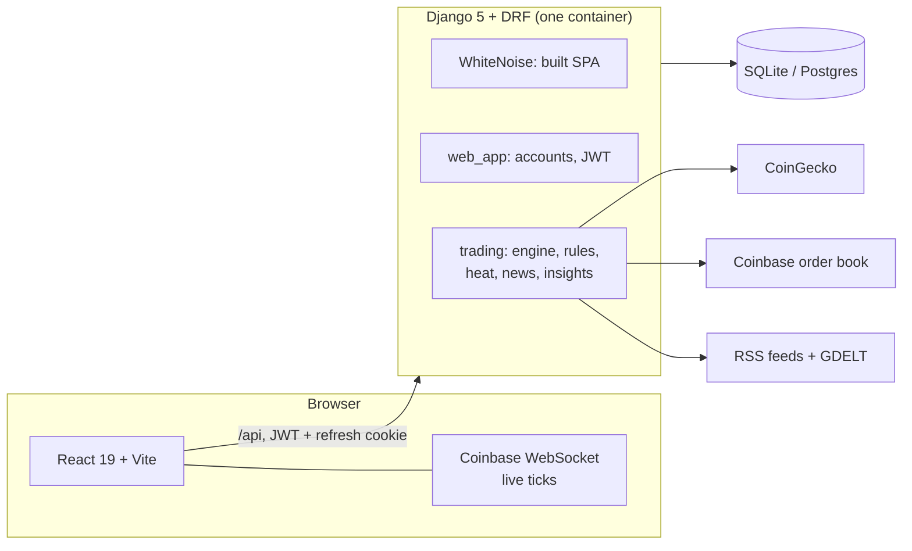

# CryptoDash

A paper-trading gym for crypto. You trade live markets with $10,000 of practice money, and the app trains the habits that real money punishes: overconfidence, chasing hype, and trading on tilt.

## Why

Most beginners don't lose money because they can't read a chart. They lose it to behaviour: buying what social media is excited about, trading more after a loss, and being far more confident than their results justify. Crypto makes this worse, with thin markets that are easy to move and a constant stream of hype.

Most paper-trading tools make it worse still: perfect fills, unlimited money and a leaderboard. CryptoDash keeps the market real and puts the feedback where the decisions happen.

## What it does

| | |
|---|---|
| **Realistic fills** | Server-side prices. Buys and sells walk Coinbase's live order book (or a square-root impact model for unlisted coins) and pay a 0.4% fee. You can't spend cash you don't have, set your own price, or backdate a trade. |
| **A reason for every buy** | The trade ticket asks why, how sure you are over what horizon, where you'd exit, and how you feel. Calls are checked against the price at the horizon. |
| **Heat** | Each coin's 24h move is compared with its own typical move, and its volume, headline count (relative to its size) and search trending are scored. The ticket for a hot coin explains what's driving it and holds the button for twenty seconds. |
| **News linked to coins** | CoinDesk, Cointelegraph and Decrypt headlines are tagged with the coins they mention, with a GDELT fallback for coins with little coverage. |
| **Your own rules** | Daily trade cap, daily loss limit, cool-down after a losing exit, and maximum position size. New buys pause when you hit one; selling never does. |
| **An honest journal** | Trades are append-only. You can add notes after the fact but never edit or delete a decision. |
| **Progress** | A confidence chart (stated conviction vs. hit rate), returns buying into heat vs. calm markets, buys right after a loss, returns by mood, stop discipline, and what fees and slippage have cost you. Your portfolio is always shown next to simply holding Bitcoin. |

## Architecture



- `trading/market.py`: CoinGecko reference data, Coinbase order book, fill simulation. Everything is cached, and the last good copy is served during outages instead of made-up numbers.
- `trading/engine.py`: quotes, order execution and rule checks, atomic per account.
- `trading/heat.py`, `trading/news.py`, `trading/insights.py`: the signals and the feedback.
- `web_app/`: users, authentication and the original portfolio/simulation API (kept for compatibility).
- `web_app/frontend/`: the React app. Charts use TradingView Lightweight Charts.

## Running locally

Requires Python 3.11+ and Node 20+.

```bash
python -m venv .venv && source .venv/bin/activate
pip install -r requirements.txt
cp .env.example .env            # set DJANGO_SECRET_KEY
python manage.py migrate
(cd web_app/frontend && npm install && npm run build)
python manage.py runserver      # http://localhost:8000
```

For frontend work with hot reload, run `npm run dev` in `web_app/frontend` (port 5173, proxies `/api` to Django).

Tests:

```bash
pytest
```

## Configuration

All settings come from the environment (see `.env.example`): `DJANGO_SECRET_KEY`, `DEBUG`, `ALLOWED_HOSTS`, `CSRF_TRUSTED_ORIGINS`, `CORS_ALLOWED_ORIGINS`, `DATABASE_URL`, `COINGECKO_API_KEY` (optional demo key), and the optional `RECAPTCHA_*` settings. Without reCAPTCHA configured, login doesn't ask for a captcha.

Data sources: CoinGecko (prices, metadata, history), Coinbase Exchange public API (order books, live ticker), CoinDesk / Cointelegraph / Decrypt RSS, and GDELT.

## Team

- **Pranav Anand** - Frontend Development, Scrum Master
- **Muhammad Abdullah** - Backend Development, Database
- **Suryansh Shekhawat** - Backend Development, Testing
- **Ellis Mon** - Frontend Development, Database
- **Elvern Keefe Chen** - Frontend Development, Testing

## License

This project was developed as part of ELEC3609/ELEC9609 at the University of Sydney.
